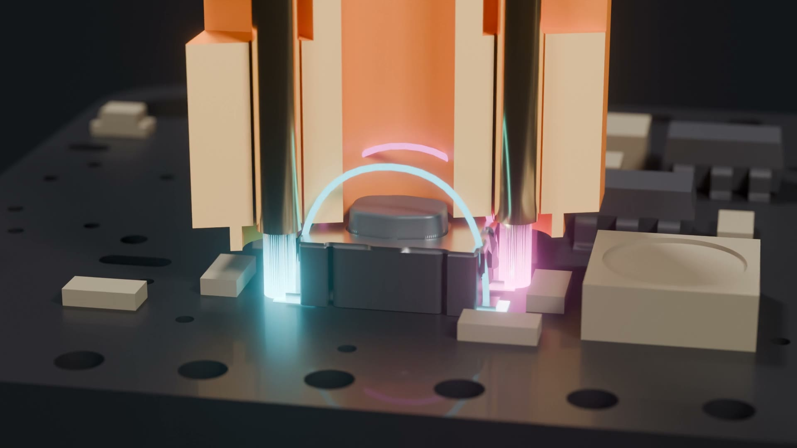
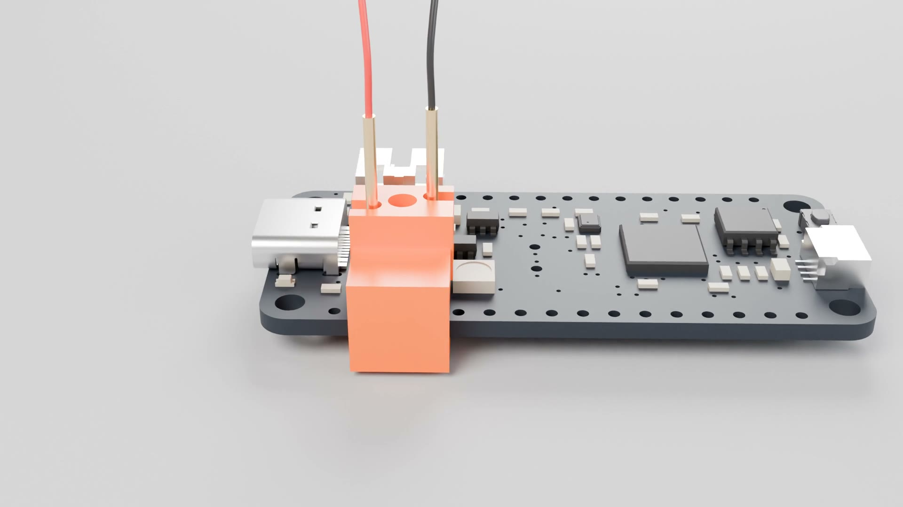
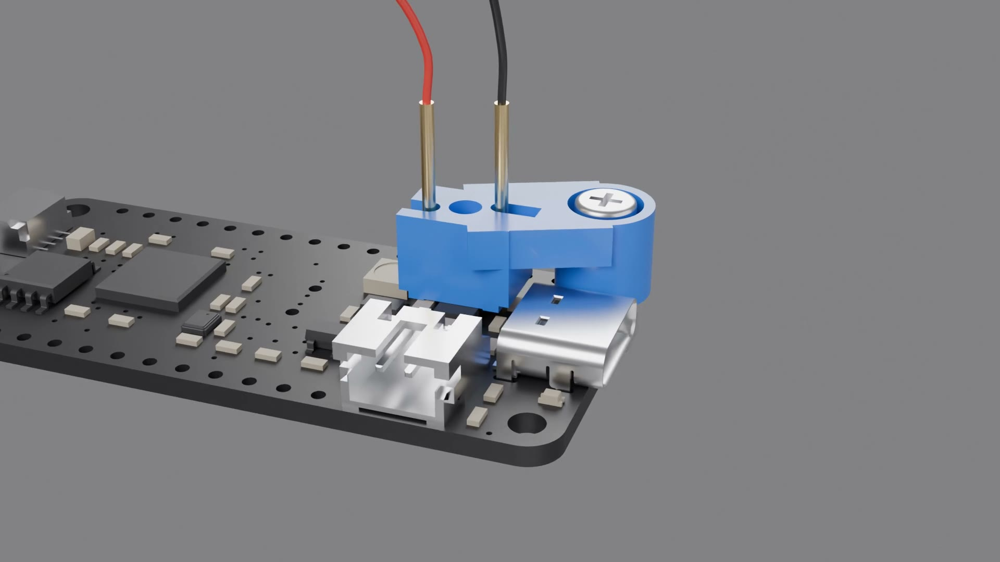

# Digital Index Operator

3D printed clips that hold two pogo pins on a board's RESET or BOOT button, so a test rig can press it with a relay.

George Jetson's job at Spacely Sprockets was digital index operator: he pressed one button all day. These clips do the same for hardware-in-the-loop testing.

**Page with videos:** https://mikeysklar.github.io/digital-index-operator/

How it works: the clip holds two pogo pins on opposite corner pads of the switch (click for the video).

| Edge clamp | Hole mount |
|---|---|
|  |  |
| Clamps the nearest board edge. Works on every board. | Screws through a mounting hole (M2.5 Feather, M3 Metro). |

## Files

- `3mf/` ready to print. Start with `3mf/fitted/` and `3mf/bore_coupon.3mf`.
- `freecad/` parametric FreeCAD 1.1 models. Pick a board row or switch type in the `Params` sheet, or enter your own edge distance or hole position. See [freecad/README.md](freecad/README.md).

## Parts

- [Pogo Pins "Needle Head" P75-B1](https://www.adafruit.com/product/2430), two per clip
- [M2.5 Nylon Screw Set](https://www.adafruit.com/product/3299) (Feather) or [M3 Nylon Screw Set](https://www.adafruit.com/product/4685) (Metro), hole mount only
- [Silicone Cover Stranded Wire 30AWG](https://www.adafruit.com/product/2051)
- [STEMMA Non-Latching Mini Relay](https://www.adafruit.com/product/4409) to press the button from a microcontroller
- [Pre-Cut Heat Shrink Pack](https://www.adafruit.com/product/4559)

## License

[MIT-0](LICENSE)
